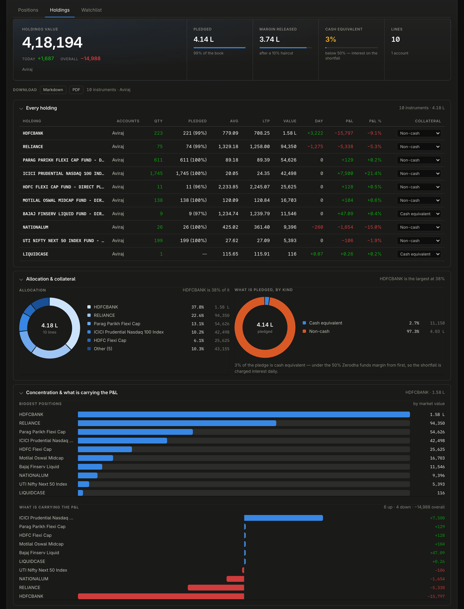
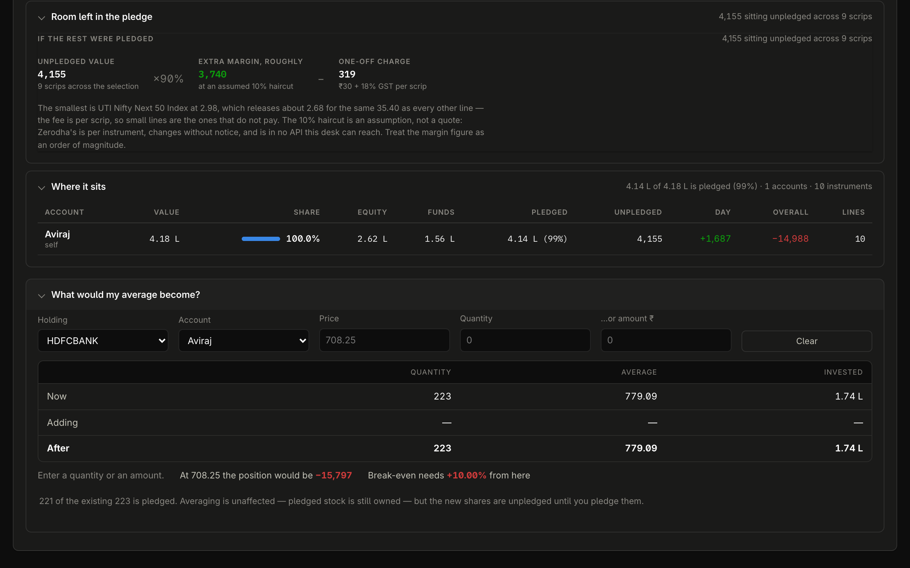
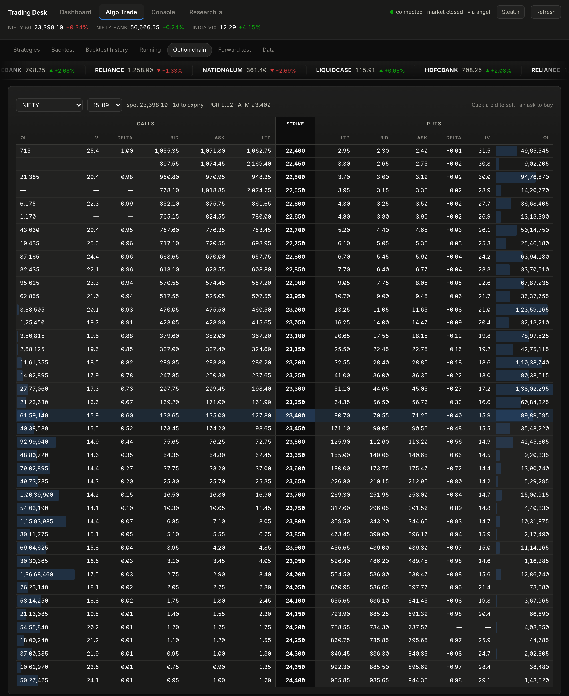
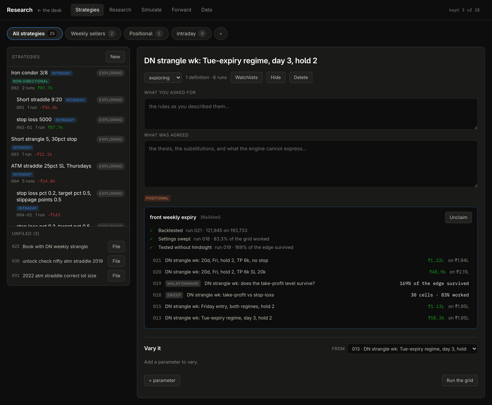
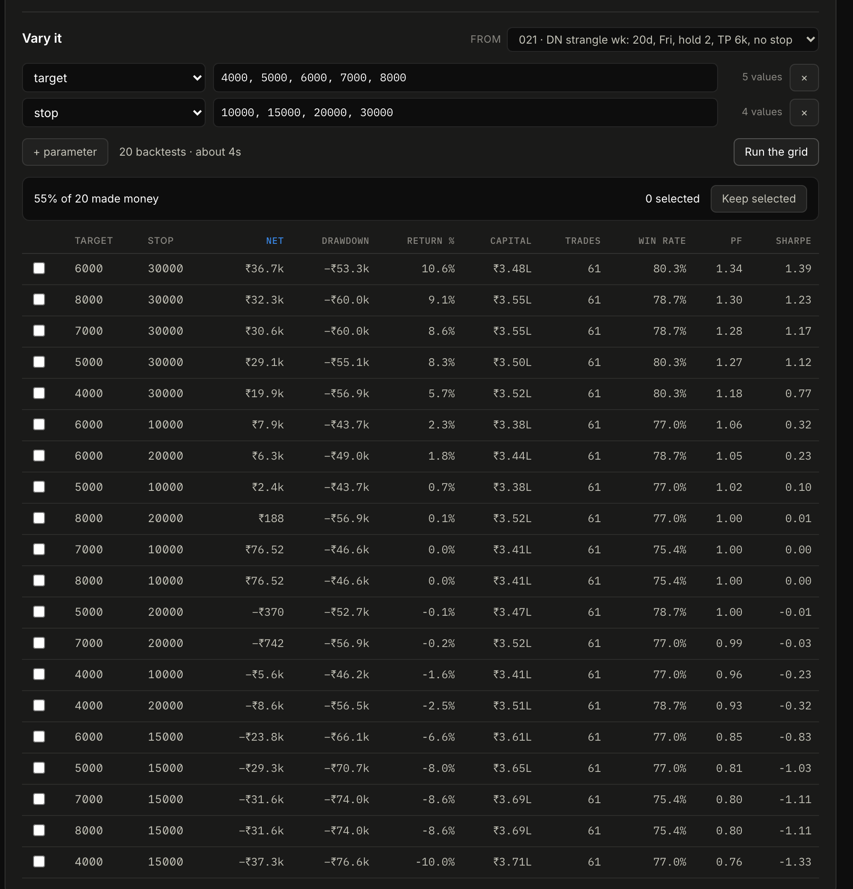

# Trading Desk

> **The platform in these screenshots is not available, and will not be.** It
> logs into real brokerage accounts — mine and my family's — and every number on
> it is somebody's actual money, margin and holdings. What ships in this
> repository is the research half: the backtest engine, its tests, the document
> it is operated from, and six worked runs. The live desk, the market-data lake,
> the backfill tooling and every credential stay private.
>
> Everything below is captured from my own account. The capital in it is small,
> but it is real money and the desk is managing it every session, which is the
> point of showing it rather than a demo book.

A trading desk for NSE index options that I built for my own option selling.
One definition of a strategy, three runtimes — backtest, paper, live monitoring
— and the apparatus that says whether the thing is doing what I thought.

---

## The data, and why the backtests run in milliseconds

Historical 1-minute bars for **expired** Indian index options are the hard part.
No single vendor has them all, so the lake was assembled from four sources over
**2019 → 2026** and reconciled where they overlap:

| Source | What it gave | Reach |
|---|---|---|
| **ICICI Breeze** | the full NIFTY chain, every strike, 1-minute | **2019-01-01 → 2026-09**, 209.5M bars |
| **Upstox** | full chain, every strike, with contract identity | 2022-07 → 2026-08, 141.8M bars (NIFTY) + BANKNIFTY + SENSEX |
| **Dhan** | rolling series indexed by moneyness, ±10 strikes | 2021-08 → 2026-08, 38.9M bars per index |
| **My own recorder** | the live feed sampled every 5 s into 1-minute bars, ±60 strikes | since 17 Aug 2026, forever |

Measured out of the lake, not estimated (`DATA.md` in this repo is generated
from it and reproduced verbatim):

- **583 million option bars** across NIFTY, BANKNIFTY and SENSEX, **9.0 GB** of
  zstd Parquet in 739 files, queried in place by DuckDB. No server, no
  subscription, no cloud.
- NIFTY full chain: **1,674 sessions, 454 strikes, 385 expiries**, 2019-01-01
  → 2026-09-02, with **68,709** contract listings carrying the lot size, tick
  size and weekly/monthly flag in force when each was listed.
- Per-bar spot, derived moneyness, implied vol on 90–100% of rows (solved from
  put–call parity where the vendor serves none), open interest and volume.
- Two STT regime changes, three NIFTY lot-size revisions (25 → 75 → 65) and the
  Thursday→Tuesday expiry move all inside the window — every trade is charged
  and sized at the rule in force on its own day.

### Vectorised, so a variation costs 100 ms instead of 30 seconds

The hosted backtesters I used before this treat every run as a fresh job: change
one stop-loss and wait **10–30 seconds** for the answer, per variation. This
engine does the expensive part **once** — contract selection in SQL over the
Parquet, one scan — and everything after that is **numpy over the loaded
matrix**. Nothing iterates minute by minute in Python.

Measured on this machine, on the lake above, the night these screenshots were
taken:

| Run | First run (loads the contracts) | Every variation after |
|---|---|---|
| ATM short straddle, 2 legs, 1,232 sessions (2021–2026), 463k bars | **3.9 s** | **96 ms** median (93–120 ms over 30 variations) |
| Iron condor, 4 legs, same window | 3.6 s | **110 ms** |
| ATM straddle on the full chain, **1,790 sessions, 2019 → 2026** | 35 s | ~100 ms |
| 64-cell grid (stop × target × slippage) from the CLI, straddle | — | **18 s wall** for all 64, load included |
| 20-cell grid from the browser, a delta-selected positional strangle on dated expiries | — | 29 s for all 20 |
| 4-fold walk-forward over 7 settings, same strangle | — | **2.1 s** |

That is roughly **100–300× per variation** once the contracts are in memory,
and it changes what a backtest *is*. A single number is one draw; at 100 ms a
draw you can afford the whole neighbourhood:

- **Sweep** the stop, the target, the slippage and the entry in one grid and
  read the *share of the grid that made money* — a plateau is an edge, a single
  bright cell surrounded by losses is a curve fit. The 64-cell straddle grid
  above reported **3 of 64 settings profitable (5%)**, which is the answer
  "there is no stop that saves this strategy", in eighteen seconds.
- **Walk it forward**: pick the best setting on the past only, trade it blind
  through the next fold, and report what share of the in-sample edge survived.
  Below 50% the tuning was fitting noise. Run 010 in this repo is the honest
  version of run 008: a sweep promised +₹264 a trade with hindsight, choosing
  blind returned +₹66. Efficiency 36%.
- **Count the attempts.** Every run and every grid cell is a chance for
  something to look good by accident, so every attempt is logged, kept or
  discarded — "kept 3 of 28" is on the page, and it is the denominator that
  makes the survivors mean anything.

The engine's own timing line is printed at the foot of every report
(`Run over 463,011 bars in 5860 ms`), so the claim is checkable on every run.

---

## A tour of the desk

Captured from a live session on 13–14 September 2026, market closed, on my
account only — the other two accounts on the desk are hidden with the desk's
own per-browser hide, which recomputes every total over what is visible.

### 1. The dashboard

One screen for the book. Options P&L split into booked, open and today; margin
used and free; the odds of spot touching the nearest breakeven (priced on the
book's own implied vol); greeks in rupees; max loss at expiry against capital;
concentration; the holdings that fund the margin; and the P&L since the desk
started recording, against the theta it was carrying.


Positions are grouped by underlying and then by account, so three accounts short
the same strike read as one concentrated risk. Each group carries its payoff at
expiry, in 7 days and now; breakevens and the distance to the nearest one; margin
from Kite's own basket calculator, with the hedge benefit named (**₹2.33 L
deployed against ₹2.48 L leg by leg — ₹15,800 saved by hedging**); and legs you
can link into a named structure with its own max profit, max loss and
profit-left.


### 2. Holdings and collateral

Holdings merged by symbol, with what is pledged, the margin it releases after
haircut, and — the number Zerodha charges interest on — how much of the pledge is
cash equivalent. Allocation and concentration, what is carrying the P&L, how much
sits unpledged and what pledging it would release, and an averaging calculator
that shows the position's P&L *after* the buy beside the P&L now, because buying
at the market lowers the average and does not reduce the loss.





### 3. The Console — how the book has actually done

Reconstructed from Zerodha's own exports rather than the live feed, so it reaches
back before the desk existed. Three lines indexed to 100: an equity NAV
(unit-NAV, so buying more stock does not move it), the **options return on the
whole portfolio** (net F&O P&L over the collateral base, compounded daily), and
the two combined. Under them, F&O P&L by month with the portfolio on the month's
first trading day as the base, and every charge head with where the figure came
from — a statement, a dated ledger line, or an estimate, and it says which.


### 4. Option chain and strategy builder

The chain for the three indices and every F&O stock, priced off the bid/ask mid
and the **synthetic forward from put–call parity** rather than spot — the reason
the desk's IVs agree with Sensibull's. Click a bid to sell it, an ask to buy it,
or load a structure. The builder gives net premium, max profit and loss,
breakevens, probability of profit, combined greeks, a margin estimate, and the
payoff at expiry and at T+n, and can load the live book as its starting basket
to ask "what does adding this do to what I already have".




### 5. Forward test, and strategies running on live prices

A paper book with its own capital, marked against the same live feed. Entries
stamp at the price that was really on screen, expired legs settle at intrinsic,
and the equity curve is recorded through the session.


Set a saved strategy's status to *paper* and the runner takes it from there:
every session it enters at the strategy's own entry time against live prices,
applies the same exits, and books the result — using the **engine's own
functions**, not a second implementation, which is the whole "my backtest worked
but live lost money" genre closed at the source. The page leads with the gap
between what the strategy is making per trade and what the backtest said to
expect. It places no orders.


### 6. Research — strategies, and the evidence ladder

Every strategy is a named idea that *claims* definitions; the numbered runs are
the evidence and are never edited. What a strategy can say about itself is
derived, never typed: **backtested** (a full run exists), **settings swept** (the
neighbourhood was tested — and what share of it worked), **tested without
hindsight** (a walk-forward exists *and its efficiency held up*). A walk-forward
that ran and failed shows as a warning, because it is worse evidence than never
having run one.



### 7. Opening a run — the analysis dashboard

Everything open, nothing collapsed, all of it derived from the stored report so
every run on disk gets the whole dashboard without re-running.

Headline: net after charges, the capital you would actually have needed (peak
margin **plus** the worst drawdown — an account sized to the margin alone would
have been wiped out by the strategy's own worst stretch), return on that capital,
Sharpe and Sortino, and the equity curve with how far underwater it went.


Every session as one square, coloured by what it made — hover for that day's
entry, exit, strikes, MFE/MAE and the itemised charges it paid. A year × month
grid. And the distribution of days, because a profit factor is produced both by
a strategy that wins a little most days and by one carried by three outliers,
and only the shape separates them: here the best five sessions are **13.8% of
gross profit**.


Thirty-odd metrics including Calmar, ulcer index and expectancy; **every**
drawdown episode rather than the worst, with how long each took to recover;
and how far each trade ran before it was closed.


The same trades in a different order. The realised drawdown is one draw; 2,000
reshuffles give the typical and the unlucky one, and the capital to size off
the latter. Then correlation against whichever other runs you tick — two
strategies near +1 are one bet at double size.


### 8. Vary it — a grid in seconds, from the page

Any number of parameters, each a list or a range, full product. This is the
20-cell grid from the timing table — target × stop on the weekly delta-neutral
strangle — run live from the browser and back in 29 seconds: **55% of 20 made
money**, sorted by net, with the drawdown, capital and Sharpe of every cell
beside it. Tick the ones worth keeping and each is re-run in full as a numbered
child strategy under its parent.



### 9. Walk it forward — the same grid without hindsight

Chosen on the past, traded on the future it could not see, 2.1 seconds for four
folds. The page says out loud when the chosen setting *changed* between folds,
because that is itself the finding: there was never a stable optimum.


### 10. The lab, and every attempt

Sweep or walk-forward any saved run. Under it, the append-only attempts log —
recording a run costs an id, exploring costs nothing, but every exploration is
still counted, because a denominator made only of the runs somebody chose to
keep is not a denominator. (The eight "timing straddle" lines are the runs
behind the table at the top of this page, discarded on purpose.)


The session simulator replays a stored day minute by minute with a structure on,
for the intuition a number cannot give.


### 11. Every run, numbered, whether it worked or not

The registry. Returns are on the capital an account would actually have needed,
not on margin. Stars are a shortlist; tick boxes feed the correlation matrix.


### 12. Stealth mode

Because the desk aggregates several people's accounts, showing it to anyone
means showing them balances that are not mine. One keystroke masks every rupee
figure, position size and account name **on the server, at the wire** — the
browser never receives them — while market data, ratios and the payoff curve's
shape survive. Turning it off needs a PIN, checked on the server, because by
then the other person is the one at the keyboard.


---

## The problem the engine exists to solve

A backtest that is wrong does not raise an exception. It returns a number, the
number is plausible, and you act on it.

Three real examples from this engine's own history, all found after they had
been producing results for a while:

**Legs that quietly followed the money.** Strike selection used to re-evaluate
every minute, so a position re-selected the at-the-money strike as spot moved.
That is not a straddle — it is a strategy that *cannot lose to a directional
move*. It reported a Sharpe of 14.7 and a 92% win rate. On 4 June 2024 it
recorded +₹11,459 for a trade that actually lost ₹24,019. The same short
straddle reads **+₹36.2 L with re-striking on, against −₹36,792 with legs
pinned to the strike they entered.** Nothing errored. Legs are now pinned by
default and `restrike` is opt-in for strategies that genuinely roll.

**A safety rule that was a no-op.** `--dte-min 4 --dte-max 4 --hold 2` returned
P&L byte-identical to `--hold 0`. The days-to-expiry band was filtering the
session list rather than the entry days, so the sessions a position needed to
be *carried through* were removed before the schedule was built. Every position
truncated to a single day, and the report labelled it "cut short by a contract
roll" — a silent no-op wearing the label of a deliberate rule.

**A held position spliced across two contracts.** Expiry was resolved per
session instead of per position, so when the front expired mid-hold the ladder
shifted underneath the trade and later sessions were marked against a contract
it had never traded. That reported **−₹94,168 for a strategy that made
+₹78,284.**

Every one of these produced a plausible number and no error. That is the
failure mode this codebase is organised against, and it is why the tests read
the way they do: many of them pin a specific wrong answer that was once
returned, and their docstrings say which. The section of `BACKTESTING.md`
called *"Conventions that will bite you"* is the running list.

---

## What the engine does about it

**Rules are written the way they are spoken.** The leg grammar is the interface,
so the gap between the rule in your head and the rule that ran is small enough
to see:

```
SELL CE 0          the at-the-money call
SELL CE @120       the call trading nearest ₹120
BUY CE @atm/3 x3   three lots of the call nearest a third of the ATM call's premium
SELL CE 20d        the 20-delta call
SELL PE 1%         the put 1% out of the money
```

Repairs are written the same way — `--adjust "gap>=40%: roll-cheap-to-expensive"`,
`--wings breakeven`. The grammar is wider than it looks; it is specified in
`BACKTESTING.md`.

**Costs are date-scoped, and usually larger than the edge.** STT on options rose
twice inside the test window — 0.0625% to 0.10% in Oct 2024 to 0.15% in Apr 2026
— and exchange fees moved with it. Each trade is charged at the rates in force
on its own day. The baseline short straddle is **+₹1.17 L gross and −₹36,792
net**: a strategy that works and a strategy that pays for itself are different
questions, so every report gives both.

**Lot sizes are read off the contracts, not assumed.** NIFTY went 25 to 75 to 65
inside this window. P&L scales linearly with lot size, so a multi-year run at
one fixed size is wrong on one side of every revision.

**Margin is modelled, and it is the denominator.** SPAN scenario loss plus
exposure on genuinely uncovered shorts, capped at max loss when bounded, never
below the net premium paid. Reports separate *peak margin* from *capital you
would actually need* — for the baseline straddle, ₹2.05 L against ₹3.77 L,
because an account sized to the margin alone would have been wiped out by the
strategy's own worst stretch.

**The reports argue against their own results.** A sweep prints how many
variations you have now looked at, because running enough of them makes one look
significant on noise alone. A walk-forward prints how much of the in-sample edge
actually survived:

> **Efficiency 36%.** Only 36% of the in-sample edge carried into the periods it
> was not chosen on. Below about 50% the optimisation is mostly fitting noise,
> and the honest expectation for this strategy is the out-of-sample row, not the
> sweep's headline.

That is run 010, where a sweep promised +₹264 a trade with hindsight, and
choosing blind and trading forward returned +₹66.

**Every run is numbered, saved and reproducible.** One command runs the strategy,
computes the report, allocates the next id and writes `db/backtests/NNN-slug/` —
the report, the result, and the exact spec that produced it. Results are never
assembled by hand from library calls. `verify` re-runs every stored run from its
own spec and fails if a single net figure has drifted by a rupee, which is what
stands between a refactor and silently changing what every stored backtest
means.

---

## The six runs in this repository

Read `report.md` in any of them; they are written to be read on their own.

| | Run | Why it is here |
|---|---|---|
| 001 | Short straddle 9:20 | The baseline, and it **loses** — +₹1.17 L gross, −₹36,792 net. A cost problem, not a signal problem |
| 002 | Iron condor 3/8 | Same window, profitable, defined risk — and the return-on-margin caveat that makes it look better than it is |
| 008 | Is 25% the lucky stop? | A parameter sweep: 16 of 18 settings profitable, with the multiple-comparisons warning printed alongside |
| 010 | Does the 25% stop survive? | Walk-forward. The honest version of run 008, and the reason to distrust it |
| 022 | Book with DN weekly strangle | A portfolio backtest — several strategies sharing one capital base |
| 029 | Monthly DN strangle, with gap repair | Mid-trade adjustment: a repair rule expressed in the grammar, and tested |

They were produced against the lake described above. **That data is not in
this repository** — it is licensed, and not mine to redistribute — so the runs
can be read but not re-run here. `DATA.md` describes exactly what it covers:
which years, which strikes, and which columns are actually populated.

---

## Running it

Python 3.12. Four dependencies: duckdb, pyarrow, numpy, pytest.

```bash
python -m venv .venv
.venv/bin/pip install -r requirements.txt
.venv/bin/python -m pytest            # 428 tests, ~30s
```

**The test suite is the part you can actually run.** It needs no data and no
credentials: the tests that exercise the engine build small synthetic lakes in a
temporary directory and point the loader at them, which is what makes the whole
thing testable without shipping 9 GB. The private repository carries 1,091
tests; the 428 here are the engine's.

The CLI runs, and reads the six saved runs:

```bash
cd backend
../.venv/bin/python -m tools.backtest list
../.venv/bin/python -m tools.backtest show 010
```

`tools.backtest run` will start and then tell you it found no data, which is the
intended behaviour rather than a crash:

```
no trades: no trades — is the lake backfilled for this range?
```

---

## Layout

```
BACKTESTING.md              the contract: grammar, coverage, limits, how to report a result
DATA.md                     what the data covers — generated from the lake, reproduced verbatim
docs/screenshots/           the live desk, captured from my own account
backend/app/backtest/       the engine: strike selection, costs, sweeps, walk-forward,
                            Monte Carlo, portfolios, mid-trade adjustment, the run registry
backend/app/quant/          Black-Scholes and Black-76 greeks, payoff curves, risk, strategy specs
backend/app/data/           the Parquet lake loader and its schema
backend/tools/backtest.py   the CLI every run goes through
backend/tests/              428 tests
db/backtests/               six worked runs
```

**Reading order.** `BACKTESTING.md` first — it is the contract, and the two
sections worth reading even if you never run anything are *"Conventions that
will bite you"* and *"What the data cannot support"*. Then a report, `010` for
preference. Then `backend/app/backtest/engine.py`.

Two things to expect in `BACKTESTING.md`: it is reproduced verbatim from the
private repository, so it opens with instructions addressed to an AI assistant
working in that repo, and its shell examples carry that machine's paths. Both
are left alone, because the document is worth more unedited than tidied.

---

## What is not here

The live half of the desk — everything in the screenshots above: the
three-account dashboard, the Console, the chain and builder, the forward test
and runner, the research pages, stealth mode, the failover chain of market-data
feeds it runs on. Along with the lake, the backfill and recording tooling, and
every credential. Two modules that are here — `quant/risk.py` and
`quant/forward.py` — belong to that dashboard rather than to the engine, and
`risk.py` is missing one test that asserted it reaches the dashboard's totals,
because the dashboard is not here to assert it against.

There is no execution layer anywhere in the project. Orders are placed by hand.
